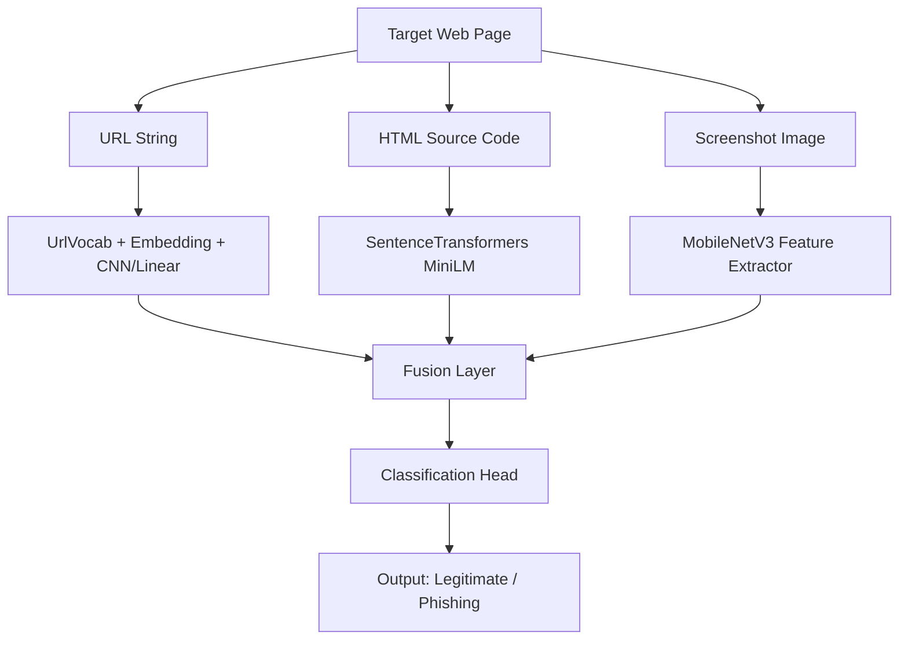
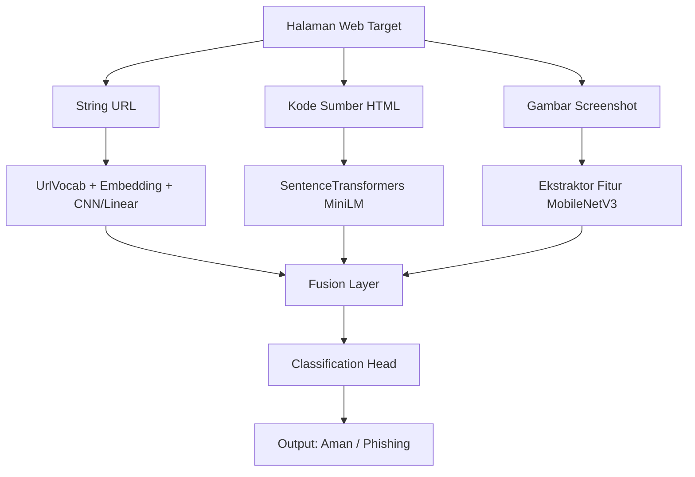

# PhishCross: Multimodal Deep Learning for Phishing Detection

[](#navigation)
[](https://www.python.org/)
[](https://pytorch.org/)
[](https://onnxruntime.ai/)
[](https://gradio.app/)

---

<a name="navigation"></a>
## Navigation / Navigasi
* [English Version](#english-version)
* [Versi Bahasa Indonesia](#versi-bahasa-indonesia)

---

<a name="english-version"></a>
# English Version

## Introduction
PhishCross is a research project developed as part of my Undergraduate Thesis (Tugas Akhir / Skripsi) in Computer Science (S1 Teknik Informatika). This project explores the intersection of Deep Learning, Cybersecurity, and Software Engineering. 

Traditional phishing detection systems often rely solely on single-modality features, such as analyzing the URL string or checking domain blacklists. However, modern attackers easily bypass these defenses by cloning visual layouts and HTML structures. Under the supervision of my academic advisors, I developed PhishCross, a cross-modal (multimodal) deep learning classifier that analyzes three complementary modalities in parallel:
1. **URL Modality:** Detects lexical abnormalities and suspicious subdomains.
2. **HTML Modality:** Captures semantic anomalies and malicious form behaviors from the source code.
3. **Visual Modality:** Analyzes the visual layout and screenshot of the website.

To bridge the gap between academic research and production deployment, this project implements a complete Software Engineering pipeline. The heavy PyTorch model is optimized and exported to ONNX Runtime, enabling low-latency CPU-only inference suitable for real-time applications.

---

## Technical Architecture

The architecture of PhishCross consists of three distinct feature extractors fused into a joint classification head:



### 1. URL Modality Processing
* **Input:** Raw URL string (e.g., `http://paypal-security-verification.com/login`).
* **Tokenizer:** `UrlVocab` constructs a vocabulary from characters/substrings.
* **Architecture:** The tokens are converted to dense vectors through an Embedding Layer, followed by a sequence processing network.

### 2. HTML Modality Processing
* **Input:** Raw HTML source code.
* **Preprocessing:** `clean_html_text` extracts text contents and strips excessive tags, limiting noise.
* **Feature Extractor:** Uses `sentence-transformers/all-MiniLM-L6-v2` to map the cleaned HTML text into a 384-dimensional semantic embedding space.

### 3. Visual Modality Processing
* **Input:** Visual screenshot of the web page.
* **Preprocessing:** Resized to $224 \times 224$ pixels and normalized using ImageNet statistical constants.
* **Feature Extractor:** Uses the features extracted from a pre-trained `MobileNetV3` network (small variant) to act as a lightweight visual layout descriptor.

---

## Directory Structure

```text
phishcross/
├── docs/                        # (Ignored) Additional project documentation and guides
├── literature/                  # (Ignored) Reference papers, journals, and academic literature
├── mcnemar_eval/                # Scripts to perform statistical McNemar tests on checkpoints
├── phishcross_result/           # (Ignored) Training checkpoints (.pt), logs, and TensorBoard outputs
├── running-kaggle/              # Core training package
│   ├── phishcross/              # Neural network configurations, dataloaders, and model definitions
│   ├── run_all_experiments.py   # Script to trigger the training pipeline across configurations
│   └── requirements.txt         # Core dependencies for the training phase
├── export_to_onnx.py            # Converts PyTorch model states (.pt) into optimized ONNX graph
├── real_demo_onnx.py            # Gradio Web GUI powered by ONNX Runtime for CPU inference
├── phishcross_optimized.onnx    # Exported ONNX model graph
└── .gitignore                   # Version control exclusions
```

---

## System Requirements & Installation

### Prerequisites
* Python 3.8 or higher
* Recommended: Conda or virtualenv environment

### Step-by-Step Installation
1. Clone the repository:
   ```bash
   git clone <repository-url>
   cd phishcross
   ```

2. Install core dependencies for training:
   ```bash
   pip install -r running-kaggle/requirements.txt
   ```

3. Install inference and UI dependencies:
   ```bash
   pip install onnx onnxruntime gradio
   ```

---

## Usage Guide

### 1. Model Training
Run the training pipeline across different seed configurations:
```bash
python running-kaggle/run_all_experiments.py
```
Checkpoints will be saved in `phishcross_result/phishcross_runs/checkpoints/`.

### 2. Exporting to ONNX
To prepare the trained model for production deployment (CPU inference), run:
```bash
python export_to_onnx.py
```
This script traces the PyTorch model using dummy inputs and optimizes the graph, saving it as `phishcross_optimized.onnx`.

### 3. Running the Local Demo
Launch the Gradio web application for real-time inference:
```bash
python real_demo_onnx.py
```
Open the local URL displayed in your terminal (typically `http://127.0.0.1:7860`) to test the model.

---

## Statistical Evaluation (McNemar's Test)

In cybersecurity research, comparing accuracy percentages is not sufficient to claim model superiority. This project uses the non-parametric **McNemar's Test** to evaluate if the cross-modal model performs significantly better than single-modality baselines.

The test compares the predictions of two models on the same test set using a $2 \times 2$ contingency table:

| | Model B Correct | Model B Incorrect |
|---|---|---|
| **Model A Correct** | $a$ | $b$ (Discordant) |
| **Model A Incorrect** | $c$ (Discordant) | $d$ |

The McNemar test statistic ($\chi^2$) is calculated as:
$$\chi^2 = \frac{(|b - c| - 1)^2}{b + c}$$

A $p$-value $< 0.05$ indicates that the difference in model performance is statistically significant. Run the evaluation script inside `mcnemar_eval/` to reproduce the results.

---

## Academic Disclaimer & Cybersecurity Ethics
This project is intended for research, academic evaluation, and defensive security applications. The author is not responsible for any misuse, reverse engineering of security systems, or unauthorized scanning of production sites. Please use this tool responsibly and in compliance with local laws.

---

## Author & License
* **Author:** Afrizal Ilza Munadhif - gixNexus
* **Contact:** [GitHub Profile](https://github.com/ustadzCoding-dev) | Email: `ilzamunadhif@gmail.com`
* **Copyright:** Copyright (c) 2026 gixNexus. All rights reserved.
* **License:** This project is licensed under the MIT License.

---

<br/>
<hr/>
<br/>

<a name="versi-bahasa-indonesia"></a>
# Versi Bahasa Indonesia

## Pendahuluan
PhishCross adalah proyek penelitian yang dikembangkan sebagai bagian dari Tugas Akhir / Skripsi saya pada program studi S1 Teknik Informatika. Proyek ini mengeksplorasi integrasi antara Deep Learning, Keamanan Siber (Cybersecurity), dan Rekayasa Perangkat Lunak (Software Engineering).

Sistem deteksi phishing tradisional umumnya hanya bergantung pada satu modalitas fitur, seperti analisis string URL atau pemeriksaan daftar hitam (blacklist) domain. Namun, penyerang modern dapat dengan mudah melewati pertahanan tersebut dengan menduplikasi tata letak visual dan struktur HTML secara presisi. Di bawah bimbingan para dosen pembimbing saya, saya mengembangkan PhishCross. sebuah model klasifikasi deep learning cross-modal (multimodal) yang menganalisis tiga aspek web secara paralel:
1. **Modalitas URL:** Mendeteksi kejanggalan leksikal dan subdomain mencurigakan pada URL.
2. **Modalitas HTML:** Menangkap anomali semantik dan perilaku formulir berbahaya dari kode sumber HTML.
3. **Modalitas Visual:** Menganalisis tata letak visual dan tangkapan layar (screenshot) situs.

Untuk menjembatani kesenjangan antara penelitian akademis dan implementasi siap pakai (production), proyek ini menerapkan alur rekayasa perangkat lunak yang lengkap. Model PyTorch yang berat dioptimasi dan diekspor ke dalam format ONNX Runtime, memungkinkan proses inferensi berlatensi rendah yang berjalan murni pada CPU tanpa bergantung pada GPU.

---

## Arsitektur Teknis

Arsitektur PhishCross terdiri dari tiga ekstraktor fitur independen yang digabungkan ke dalam satu kepala klasifikasi (classification head):



### 1. Pengolahan Modalitas URL
* **Input:** String alamat URL mentah (misal: `http://paypal-security-verification.com/login`).
* **Tokenizer:** `UrlVocab` membangun kamus token dari karakter/sub-string URL.
* **Arsitektur:** Token dikonversi menjadi vektor padat melalui Embedding Layer, diikuti dengan jaringan pemrosesan sekuensial.

### 2. Pengolahan Modalitas HTML
* **Input:** Kode sumber HTML mentah.
* **Pra-proses:** Fungsi `clean_html_text` mengekstrak konten teks murni dan membuang tag berlebih untuk mengurangi derau (noise).
* **Ekstraktor Fitur:** Menggunakan `sentence-transformers/all-MiniLM-L6-v2` untuk memetakan teks HTML ke dalam ruang representasi semantik berdimensi 384.

### 3. Pengolahan Modalitas Visual
* **Input:** Gambar tangkapan layar dari halaman web target.
* **Pra-proses:** Gambar diubah ukurannya menjadi $224 \times 224$ piksel dan dinormalisasi sesuai nilai statistik ImageNet.
* **Ekstraktor Fitur:** Menggunakan pre-trained `MobileNetV3` (varian small) untuk bertindak sebagai deskriptor visual tata letak halaman yang ringan dan cepat.

---

## Struktur Direktori

```text
phishcross/
├── docs/                        # (Ignored) Dokumentasi dan panduan tambahan proyek
├── literature/                  # (Ignored) Jurnal, paper, dan referensi akademik pendukung
├── mcnemar_eval/                # Skrip uji statistik McNemar pada hasil checkpoint model
├── phishcross_result/           # (Ignored) File checkpoint model (.pt), log, dan output TensorBoard
├── running-kaggle/              # Modul utama pelatihan model
│   ├── phishcross/              # Konfigurasi model, dataloader, dan arsitektur neural network
│   ├── run_all_experiments.py   # Skrip untuk menjalankan seluruh eksperimen pelatihan
│   └── requirements.txt         # Kebutuhan pustaka (dependencies) untuk pelatihan
├── export_to_onnx.py            # Mengonversi checkpoint PyTorch (.pt) menjadi graf model ONNX
├── real_demo_onnx.py            # Aplikasi web Gradio berbasis ONNX Runtime untuk inferensi CPU
├── phishcross_optimized.onnx    # Graf model ONNX hasil ekspor
└── .gitignore                   # Konfigurasi pengecualian sistem kontrol versi (Git)
```

---

## Kebutuhan Sistem & Instalasi

### Prasyarat
* Python 3.8 atau versi di atasnya
* Direkomendasikan: Lingkungan virtual `venv` atau `conda`

### Langkah-Langkah Instalasi
1. Klon repositori ini:
   ```bash
   git clone <repository-url>
   cd phishcross
   ```

2. Instal pustaka inti untuk proses pelatihan:
   ```bash
   pip install -r running-kaggle/requirements.txt
   ```

3. Instal pustaka tambahan untuk inferensi dan antarmuka pengguna:
   ```bash
   pip install onnx onnxruntime gradio
   ```

---

## Panduan Penggunaan

### 1. Pelatihan Model
Jalankan alur eksperimen pelatihan model dengan beberapa konfigurasi seed:
```bash
python running-kaggle/run_all_experiments.py
```
File bobot model (.pt) akan disimpan pada direktori `phishcross_result/phishcross_runs/checkpoints/`.

### 2. Ekspor ke ONNX
Untuk mempersiapkan model siap pakai (deployment) dengan performa cepat di CPU, jalankan:
```bash
python export_to_onnx.py
```
Skrip ini akan melakukan *tracing* model PyTorch menggunakan data dummy, mengoptimalkan graf komputasi, dan menyimpannya sebagai `phishcross_optimized.onnx`.

### 3. Menjalankan Demo Aplikasi Web
Buka antarmuka demo interaktif berbasis Gradio untuk pengujian lokal:
```bash
python real_demo_onnx.py
```
Buka tautan lokal yang tertera pada terminal Anda (biasanya `http://127.0.0.1:7860`) untuk mulai menguji model secara real-time.

---

## Evaluasi Statistik (Uji McNemar)

Dalam riset keamanan siber, sekadar membandingkan persentase akurasi belum cukup kuat untuk membuktikan keunggulan model. Proyek ini menyertakan evaluasi statistik non-parametrik **Uji McNemar** untuk memvalidasi apakah model multimodal berkinerja secara signifikan lebih baik dibandingkan model bermodalitas tunggal (baseline).

Pengujian dilakukan dengan menyusun tabel kontingensi $2 \times 2$ berdasarkan prediksi kedua model pada set data uji yang sama:

| | Model B Benar | Model B Salah |
|---|---|---|
| **Model A Benar** | $a$ | $b$ (Diskordan) |
| **Model A Salah** | $c$ (Diskordan) | $d$ |

Nilai statistik uji McNemar ($\chi^2$) dihitung menggunakan formula:
$$\chi^2 = \frac{(|b - c| - 1)^2}{b + c}$$

Jika nilai $p$-value yang dihasilkan $< 0.05$, maka perbedaan performa antara kedua model dinyatakan signifikan secara statistik. Jalankan skrip evaluasi pada folder `mcnemar_eval/` untuk mereproduksi pengujian ini.

---

## Batasan Akademik & Etika Keamanan Siber
Proyek ini dikembangkan murni untuk kepentingan akademis, riset ilmiah, dan sistem pertahanan siber. Penulis tidak bertanggung jawab atas segala bentuk penyalahgunaan model, pembobolan sistem keamanan pihak lain, atau pemindaian situs web tanpa izin. Gunakan perangkat ini secara bertanggung jawab sesuai dengan peraturan hukum yang berlaku.

---

## Penulis & Lisensi
* **Penulis:** Afrizal Ilza Munadhif -gixNexus
* **Kontak:** [Profil GitHub](https://github.com/ustadzCoding-dev) | Email: `ilzamunadhif@gmail.com`
* **Hak Cipta:** Hak Cipta (c) 2026 gixNexus. Semua hak dilindungi undang-undang.
* **Lisensi:** Proyek ini dilisensikan di bawah Lisensi MIT.
